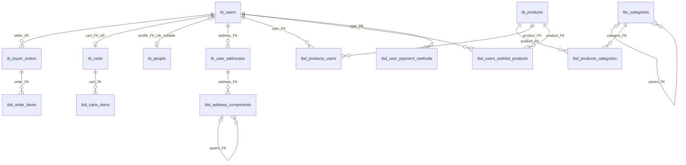

# Informe DER — `db_test_7b`

**Fuente:** `Respaldo20261022.sql` (dump MySQL 8.0.36). El archivo define 17 tablas, no solo las cinco entidades destacadas en el encargo. Este informe incluye el modelo completo; las cinco tablas principales se detallan con mayor foco. Tipos, nullabilidad y defaults se transcriben del DDL; una descripción de negocio no altera lo que el DDL garantiza.

## A. Diccionario de datos técnico

Notación: `NN` = NOT NULL; `NULL` = admite nulo; `AI` = AUTO_INCREMENT; `PK`, `FK`, `UK` = clave primaria, foránea y única. `CURRENT_TIMESTAMP` y `ON UPDATE` se indican literalmente. Los estados `BIT(1)` suelen representar activo/inactivo o éxito/fallo según su columna; el dump no declara nombres simbólicos para los bits.

### `tb_users` — cuenta de usuario

| Columna | Tipo | Nul. / clave | Regla / descripción |
|---|---|---|---|
| ID | INT | NN, PK, AI | Identificador |
| email | VARCHAR(100) | NN, UK | Correo único |
| nick | VARCHAR(50) | NN, UK | Alias único |
| password | VARCHAR(255) | NN | Credencial; el dump contiene valores con formatos distintos, véase integridad |
| creation_date | DATETIME | NN, DEFAULT CURRENT_TIMESTAMP | Alta |
| last_update | DATETIME | NULL | Última modificación; sin actualización automática declarada |
| last_login | DATETIME | NULL | Último acceso |
| status | BIT(1) | NULL, DEFAULT b'1' | Estado de cuenta |

### `tb_buyer_orders` — órdenes de venta

| Columna | Tipo | Nul. / clave | Regla / descripción |
|---|---|---|---|
| ID | INT UNSIGNED | NN, PK, AI | Identificador |
| seller_ID | INT | NN, FK → `tb_users.ID`; índice `seller_ID` | Usuario vendedor requerido |
| subtotal | DECIMAL(12,2) | NN, DEFAULT 0.00 | CHECK >= 0 |
| shipping_cost | DECIMAL(12,2) | NN, DEFAULT 0.00 | CHECK >= 0 |
| fulfillment_status | ENUM('Pending','Accepted','Preparing','Sent','Delivered','Canceled','Returned') | NN, DEFAULT 'Pending' | Estado logístico |
| status | BIT(1) | NN, DEFAULT b'1' | Bandera de estado |
| creation_date | DATETIME | NN, DEFAULT CURRENT_TIMESTAMP | Creación |
| last_update | DATETIME | NULL, ON UPDATE CURRENT_TIMESTAMP | Se actualiza al modificar la fila |

### `tb_carts` — carrito de usuario

| Columna | Tipo | Nul. / clave | Regla / descripción |
|---|---|---|---|
| ID | INT | NN, PK, AI | Identificador |
| user_ID | INT | NN, FK → `tb_users.ID`, UK `uk_cart_user` | A lo sumo un carrito por usuario |
| status | BIT(1) | NULL, DEFAULT b'1' | Estado |
| creation_date | DATETIME | NN, DEFAULT CURRENT_TIMESTAMP | Creación |
| last_update | DATETIME | NULL, ON UPDATE CURRENT_TIMESTAMP | Actualización automática |

### `tb_logs` — auditoría

| Columna | Tipo | Nul. / clave | Regla / descripción |
|---|---|---|---|
| ID | INT | NN, PK, AI | Identificador |
| table_name | VARCHAR(80) | NN | Tabla afectada; texto libre, sin FK |
| table_operation | ENUM('create','Read','update','Delete') | NULL | Acción; acepta NULL |
| db_user | VARCHAR(80) | NN | Usuario/host que reporta la operación, texto sin FK |
| operation_date | DATETIME | NN, DEFAULT CURRENT_TIMESTAMP | Índice descendente `idx_logs_operation_date` |
| operation_description | TEXT | NN | Detalle libre |
| operation_status | BIT(1) | NULL, DEFAULT b'1' | Resultado reportado |

### `tb_products` — catálogo

| Columna | Tipo | Nul. / clave | Regla / descripción |
|---|---|---|---|
| ID | INT UNSIGNED | NN, PK, AI | Identificador |
| SKU | VARCHAR(50) | NN, UK `SKU`; índice adicional `idx_products_sku` | Código único; índice redundante respecto al UK |
| name | VARCHAR(250) | NN | Nombre |
| description | TEXT | NULL | Descripción |
| current_price | DECIMAL(10,2) | NN, DEFAULT 0.00 | Precio; no existe CHECK de no negatividad |
| current_stock | INT UNSIGNED | NN, DEFAULT 0 | Existencia no negativa por ser UNSIGNED |
| status | BIT(1) | NULL, DEFAULT b'1' | Estado |
| creation_date | DATETIME | NN, DEFAULT CURRENT_TIMESTAMP | Alta |
| last_update | DATETIME | NN, DEFAULT CURRENT_TIMESTAMP, ON UPDATE CURRENT_TIMESTAMP | Modificación automática |

### Resto de entidades (modelo físico completo)

| Tabla | Columnas (tipo; nulabilidad; clave/default/reglas) |
|---|---|
| `tb_people` | `person_ID BIGINT UNSIGNED` NN PK AI; `user_ID INT` NULL UK `uk_person_user`, FK a users con DELETE SET NULL / UPDATE CASCADE; `courtesy_title VARCHAR(20)` NULL; `given_names VARCHAR(150)` NN; `family_names VARCHAR(150)` NULL; `birth_date DATE` NULL; `gender ENUM('Hombre','Mujer','Prefiero no decirlo')` NN DEFAULT 'Prefiero no decirlo'; `country_code CHAR(2)` NULL; `phone VARCHAR(25)` NULL; `status BIT(1)` NULL DEFAULT b'1'; `creation_date DATETIME` NULL DEFAULT CURRENT_TIMESTAMP; `last_update DATETIME` NULL DEFAULT CURRENT_TIMESTAMP ON UPDATE CURRENT_TIMESTAMP. Triggeres BEFORE validan/alteran campos y registran intentos (ver sección C). |
| `tb_user_addresses` | `ID INT` NN PK AI; `user_ID INT` NN FK `fk_addresses_users`, índice `idx_user_addresses`; `address_label VARCHAR(100)` NN; `recipient_name VARCHAR(150)` NULL; `recipient_phone VARCHAR(25)` NULL; `delivery_instructions VARCHAR(500)` NULL; `latitude DECIMAL(10,7)` NULL; `longitude DECIMAL(10,7)` NULL; `is_default TINYINT(1)` NN DEFAULT 0; `status BIT(1)` NN DEFAULT b'1'; `creation_date DATETIME` NN DEFAULT CURRENT_TIMESTAMP; `last_update DATETIME` NULL ON UPDATE CURRENT_TIMESTAMP. CHECK: coordenadas ambas NULL o ambas presentes; latitud [-90,90], longitud [-180,180]. |
| `tbc_categories` | `ID INT UNSIGNED` NN PK AI; `name VARCHAR(120)` NN UK; `description TEXT` NULL; `sup_id_category INT UNSIGNED` NULL FK autorreferente `fk_superior_category`; `status BIT(1)` NN DEFAULT b'1'; `creation_date DATETIME` NN DEFAULT CURRENT_TIMESTAMP; `last_update DATETIME` NN DEFAULT CURRENT_TIMESTAMP ON UPDATE CURRENT_TIMESTAMP. Índice superior. |
| `tbc_payment_methods_types` | `ID INT UNSIGNED` NN PK AI; `code VARCHAR(30)` NN UK; `description TEXT` NN; `status BIT(1)` NN DEFAULT b'1'; `creation_date DATETIME` NN DEFAULT CURRENT_TIMESTAMP; `last_update DATETIME` NULL ON UPDATE CURRENT_TIMESTAMP. |
| `tbd_address_components` | `ID BIGINT UNSIGNED` NN PK AI; `address_ID INT` NN FK a direcciones ON DELETE RESTRICT / ON UPDATE CASCADE; `value VARCHAR(255)` NN; `component_type VARCHAR(50)` NN; `status BIT(1)` NN DEFAULT b'1'; `address_sup_ID BIGINT UNSIGNED` NULL FK autorreferente ON DELETE RESTRICT / ON UPDATE CASCADE; `creation_date DATETIME` NN DEFAULT CURRENT_TIMESTAMP; `last_update DATETIME` NULL ON UPDATE CURRENT_TIMESTAMP. Índices por address y padre. |
| `tbd_carts_items` | `cart_ID INT` NN PK compuesta, FK a carrito; `provider_ID INT UNSIGNED` NN PK compuesta; `product_ID INT UNSIGNED` NN PK compuesta; `quantity INT UNSIGNED` NN DEFAULT 1 CHECK > 0; `creation_date DATETIME` NN DEFAULT CURRENT_TIMESTAMP. Índices provider/product. No hay FK declarada para provider ni product. |
| `tbd_order_items` | `ID INT UNSIGNED` NN PK AI; `seller_order_ID INT UNSIGNED` NN FK a buyer_orders; `product_ID INT UNSIGNED` NN, índice sin FK; `provider_ID INT UNSIGNED` NN, índice sin FK; `product_name VARCHAR(255)` NN; `quantity INT UNSIGNED` NN CHECK > 0; `unit_price DECIMAL(12,2)` NN CHECK >= 0; `subtotal DECIMAL(12,2)` generado STORED = quantity * unit_price; `creation_date DATETIME` NN DEFAULT CURRENT_TIMESTAMP. |
| `tbd_products_categories` | `category_ID INT UNSIGNED` NN PK compuesta y FK a categorías; `product_ID INT UNSIGNED` NN PK compuesta y FK a productos; `status BIT(1)` NN DEFAULT b'1'; `creation_date DATETIME` NN DEFAULT CURRENT_TIMESTAMP; `last_update DATETIME` NN DEFAULT CURRENT_TIMESTAMP ON UPDATE CURRENT_TIMESTAMP; índice `idx_product`. |
| `tbd_products_users` | `user_ID INT` NN PK compuesta FK a users; `product_ID INT UNSIGNED` NN PK compuesta FK a productos; `type_ownership ENUM('Owner','Reseller','Distributor')` NN; `status BIT(1)` NN DEFAULT b'1'; `avalaible_date DATETIME` NN (así está escrito); `creation_date DATETIME` NN DEFAULT CURRENT_TIMESTAMP; `last_update DATETIME` NN DEFAULT CURRENT_TIMESTAMP ON UPDATE CURRENT_TIMESTAMP. Índice product. |
| `tbd_user_payment_methods` | `ID BIGINT UNSIGNED` NN PK AI; `user_ID INT` NN FK a users; `payment_method_type_ID INT UNSIGNED` NN sin FK; `provider VARCHAR(60)` NN; `provider_method_ref VARCHAR(255)` NN; `label VARCHAR(100)` NULL; `last_four CHAR(4)` NULL; `is_default TINYINT(1)` NN DEFAULT 0; `status BIT(1)` NN DEFAULT b'1'; `creation_date DATETIME` NN DEFAULT CURRENT_TIMESTAMP; `last_update DATETIME` NULL ON UPDATE CURRENT_TIMESTAMP. UK `uk_provider_method(provider,provider_method_ref)`. |
| `tbd_users_wishlist_products` | `user_ID INT` NN PK compuesta FK users; `product_ID INT UNSIGNED` NN PK compuesta FK products; `status BIT(1)` NN DEFAULT b'1'; `creation_date DATETIME` NN DEFAULT CURRENT_TIMESTAMP; `last_update DATETIME` NN ON UPDATE CURRENT_TIMESTAMP. |

## B. Relaciones y cardinalidades

Las cardinalidades indican lo permitido por las restricciones, no el número de filas actualmente pobladas. En una FK no nula, cada fila hija requiere exactamente un padre existente; el padre puede tener cero o muchas hijas, salvo UK que limite el lado hijo.

| Relación | Cardinalidad / obligatoriedad |
|---|---|
| users → buyer_orders (seller) | 1:N; cada orden requiere un vendedor; un usuario puede no tener órdenes o tener muchas. |
| users → carts | 1:0..1; FK obligatoria en carrito, UK en `user_ID`; un usuario puede carecer de carrito. |
| users → people | 1:0..1 desde usuario; `people.user_ID` nullable y único. El perfil puede no estar asociado; al borrar usuario queda NULL. |
| users → user_addresses | 1:N; cada dirección requiere usuario. |
| user_addresses → address_components | 1:N; cada componente requiere dirección; borrado restringido. |
| address_components → address_components | 1:N autorreferente; padre opcional. |
| categories → categories | 1:N; categoría superior opcional. |
| carts → carts_items | 1:N; cada item requiere carrito. |
| products ↔ categories mediante `tbd_products_categories` | N:M; ambos lados requeridos en cada asociación. |
| users ↔ products mediante `tbd_products_users` | N:M; cada asociación requiere ambos; contiene tipo de titularidad. |
| users ↔ products mediante `tbd_users_wishlist_products` | N:M; ambos lados requeridos. |
| buyer_orders → order_items | 1:N; cada detalle requiere orden. |
| products/provider → carts_items | No garantizada por FK en este dump. Los IDs sugieren una intención, insuficiente para afirmar integridad. |
| products/provider → order_items | No hay FK declaradas para esos dos campos. |
| users → user_payment_methods | 1:N; cada método asignado requiere usuario. `payment_method_type_ID` no referencia catálogo mediante FK. |
| tb_logs → tablas auditadas | Sin relación referencial: `table_name`, `db_user` y descripción son texto; no hay ID de registro ni FK. |

## C. Mermaid ER (estructura física resumida)

```mermaid
erDiagram
  tb_users ||--o{ tb_buyer_orders : seller
  tb_users ||--o| tb_carts : owns
  tb_users o|--o| tb_people : profile
  tb_users ||--o{ tb_user_addresses : has
  tb_user_addresses ||--o{ tbd_address_components : contains
  tbd_address_components o|--o{ tbd_address_components : parent
  tbc_categories o|--o{ tbc_categories : parent
  tb_carts ||--o{ tbd_carts_items : contains
  tb_buyer_orders ||--o{ tbd_order_items : contains
  tb_products ||--o{ tbd_products_categories : categorized
  tbc_categories ||--o{ tbd_products_categories : categorizes
  tb_users ||--o{ tbd_products_users : ownership
  tb_products ||--o{ tbd_products_users : owned_product
  tb_users ||--o{ tbd_users_wishlist_products : wishes
  tb_products ||--o{ tbd_users_wishlist_products : wished_product
  tb_users ||--o{ tbd_user_payment_methods : pays_with

  tb_users {
    int ID PK
    varchar email UK
    varchar nick UK
    varchar password
    datetime creation_date
    datetime last_update
    datetime last_login
    bit status
  }
  tb_buyer_orders {
    int_unsigned ID PK
    int seller_ID FK
    decimal subtotal
    decimal shipping_cost
    enum fulfillment_status
    bit status
    datetime creation_date
    datetime last_update
  }
  tb_carts {
    int ID PK
    int user_ID FK_UK
    bit status
    datetime creation_date
    datetime last_update
  }
  tb_logs {
    int ID PK
    varchar table_name
    enum table_operation
    varchar db_user
    datetime operation_date
    text operation_description
    bit operation_status
  }
  tb_products {
    int_unsigned ID PK
    varchar SKU UK
    varchar name
    text description
    decimal current_price
    int_unsigned current_stock
    bit status
    datetime creation_date
    datetime last_update
  }
  tb_people {
    bigint_unsigned person_ID PK
    int user_ID FK_UK
    varchar given_names
    varchar family_names
    date birth_date
    enum gender
    char country_code
    varchar phone
  }
  tb_user_addresses {
    int ID PK
    int user_ID FK
    varchar address_label
    decimal latitude
    decimal longitude
    tinyint is_default
  }
  tbc_categories {
    int_unsigned ID PK
    varchar name UK
    int_unsigned sup_id_category FK
  }
  tbc_payment_methods_types {
    int_unsigned ID PK
    varchar code UK
  }
  tbd_address_components {
    bigint_unsigned ID PK
    int address_ID FK
    bigint_unsigned address_sup_ID FK
    varchar component_type
    varchar value
  }
  tbd_carts_items {
    int cart_ID PK, FK
    int_unsigned provider_ID PK
    int_unsigned product_ID PK
    int_unsigned quantity
  }
  tbd_order_items {
    int_unsigned ID PK
    int_unsigned seller_order_ID FK
    int_unsigned product_ID
    int_unsigned provider_ID
    varchar product_name
    int_unsigned quantity
    decimal unit_price
    decimal subtotal "generated stored"
  }
  tbd_products_categories {
    int_unsigned category_ID PK, FK
    int_unsigned product_ID PK, FK
    bit status
  }
  tbd_products_users {
    int user_ID PK, FK
    int_unsigned product_ID PK, FK
    enum type_ownership
    datetime avalaible_date
  }
  tbd_user_payment_methods {
    bigint_unsigned ID PK
    int user_ID FK
    int_unsigned payment_method_type_ID
    varchar provider
    varchar provider_method_ref
    char last_four
  }
  tbd_users_wishlist_products {
    int user_ID PK, FK
    int_unsigned product_ID PK, FK
    bit status
  }
```

Nota: Mermaid muestra relaciones solo cuando hay FK declarada; no conecta `tb_logs`, `tbc_payment_methods_types`, `product_ID/provider_ID` de items ni `payment_method_type_ID` porque el DDL carece de esas FKs. La sintaxis ER de Mermaid no codifica todas las acciones referenciales, CHECK ni defaults; están detallados arriba.

## D. Integridad, datos y triggers

### Datos observados

- `tb_buyer_orders`, `tb_carts` y la mayoría de tablas auxiliares tienen secciones de carga sin filas INSERT visibles. `tb_users` sí contiene cuentas (IDs no contiguos; secuencia AUTO_INCREMENT 51). `tb_products` contiene miles de productos y el dump registra `tb_logs` hasta ID 5352 (AUTO_INCREMENT 5353). La secuencia no equivale necesariamente a recuento exacto de filas.
- `tb_logs` acredita operaciones sobre `tb_users` y `tb_products` con actor, fecha, descripción y estado. Es evidencia de auditoría, no integridad relacional: no almacena FK/ID estable del registro. Hay una operación `Read` permitida por ENUM aunque muchos triggers solo auditan altas, cambios y borrados.
- `tb_products` se asocia a usuarios mediante `tbd_products_users`, que permite distinguir Owner/Reseller/Distributor; no se puede deducir vendedor de una orden por su campo `seller_ID` más allá del enlace explícito al usuario.

### Triggers hallados

Hay 39 triggers en el dump. Los triggers `AFTER INSERT/UPDATE/DELETE` de `tb_buyer_orders`, `tb_products`, `tb_user_addresses`, `tb_users`, categorías, tipos de pago, componentes de dirección y tablas puente/ítems insertan filas de auditoría. En los triggers de órdenes se insertan `table_name`, `table_operation`, `db_user`, fecha, descripción y estado en `tb_logs`; `tb_products`/usuarios y otros modelos siguen el mismo patrón. El evento lógico de una fila queda convertido a descripción textual. Para auditar un `DELETE`, el trigger captura los valores OLD.

Excepción relevante: `tb_people` tiene BEFORE INSERT/UPDATE/DELETE que realizan validación y también intentan insertar en logs. El dump de `tb_logs` declara `table_operation`, `db_user`, etc., pero algunas rutinas en el archivo (en particular triggers de asociaciones cercanos a las líneas ~1267+) insertan `action`, `record_id`, `created_at`, columnas que **no existen** en la definición mostrada de `tb_logs`. Esos triggers fallarán al ejecutarse si se crean tal cual. Verificar la definición exacta antes de restaurar; el dump contiene variantes incompatibles entre generaciones de esquema.

### Hallazgos y recomendaciones

1. **No faltan `CREATE TABLE` para `tb_users` ni `tb_products`**: ambos están definidos en el archivo. El esquema real contiene más tablas que las cinco enumeradas en el prompt; se incluyen todas arriba.
2. **Tipos de FK no siempre coinciden exactamente:** `tb_buyer_orders.seller_ID INT` referencia `tb_users.ID INT`; productos referenciados desde `INT UNSIGNED` son compatibles con `tb_products.ID INT UNSIGNED`. Revisar todas las referencias implícitas; múltiples IDs (`provider_ID`, `product_ID`, `payment_method_type_ID`) carecen de FK y admiten huérfanos.
3. **Integridad de carrito:** `UNIQUE(user_ID)` impone como máximo un carrito histórico por usuario, no solo un carrito activo. Si se quieren varios carritos históricos, cambiar la estrategia (por ejemplo índice único condicionado no disponible directamente en MySQL, columna de carrito activo, o historial separado).
4. **Totales de orden:** `tbd_order_items.subtotal` es generado, pero `tb_buyer_orders.subtotal` no está atado por constraint a la suma de detalles; tampoco se valida consistencia entre subtotal/costo de envío. Definir mecanismo transaccional.
5. **Auditoría:** corregir todos los triggers que escriben columnas inexistentes en `tb_logs`; considerar tabla/clave de registro auditado, actor con identidad estable, y vocabulario ENUM consistente (capitalización `Read` frente a otras acciones).
6. **Seguridad de credenciales:** el dump incluye contraseñas de texto claro en algunas filas y valores con longitudes/formatos distintos. Usar hash adaptativo (Argon2id/bcrypt), migrar/resetear credenciales y evitar distribuir dumps con secretos.
7. **Catálogo de formas de pago desconectado:** `payment_method_type_ID` no tiene FK a `tbc_payment_methods_types`; agregarla si ese vínculo es intencional. Evitar guardar datos de pago sensibles; `provider_method_ref` debería ser token del proveedor.
8. **Precio no acotado:** `current_price DECIMAL` carece CHECK de no negatividad, a diferencia de precio histórico de detalle. Incorporar validación si la regla de negocio lo exige.
9. **Índice duplicado en SKU:** `UNIQUE KEY SKU` ya crea índice; `idx_products_sku` repite la misma columna y puede eliminarse tras verificar dependencias de consultas.
10. **Nulabilidad inconsistente:** varios `status` admiten NULL pese a DEFAULT b'1'; decidir si NULL tiene significado o fijarlos NN. `tb_people.user_ID` usa SET NULL de forma deliberada y el resto de borrados usa acción implícita RESTRICT/NO ACTION.

**Alcance:** cardinalidades reflejan solo constraints declaradas. Las descripciones de logs y los IDs con nombres `provider` sugieren reglas funcionales, pero no son relaciones referenciales verificadas.

## E. Diagrama completo Mermaid (incluye asociaciones inferidas)

El diagrama anterior sirve como vista de FK. Esta versión agrega en comentarios las referencias plausibles sin constraint: no se dibujan como relaciones sólidas. `tb_logs` se mantiene suelta porque no hay una clave de fila auditada.



Mermaid `erDiagram` no tiene sintaxis de relación punteada/estereotipo ampliamente compatible para distinguir FK inferida. Por eso las inferencias aparecen como comentarios y deben leerse como hipótesis, no como constraints del modelo.

## F. DBML completo para dbdiagram.io

DBML conserva tablas, columnas, tipos, PK, UK, índices, defaults, checks y todas las FK declaradas. Las referencias implícitas se documentan en notas y **no** se declaran como `Ref` ejecutable.

```dbml
Project db_test_7b {
  database_type: 'MySQL'
  Note: 'Modelo del dump Respaldo20261022.sql. FKs implícitas están documentadas, no aplicadas.'
}

Table tb_users {
  ID int [pk, increment, not null]
  email varchar(100) [not null, unique]
  nick varchar(50) [not null, unique]
  password varchar(255) [not null]
  creation_date datetime [not null, default: `CURRENT_TIMESTAMP`]
  last_update datetime
  last_login datetime
  status bit(1) [default: `b'1'`]
}

Table tb_buyer_orders {
  ID int unsigned [pk, increment, not null]
  seller_ID int [not null, ref: > tb_users.ID]
  subtotal decimal(12,2) [not null, default: 0.00]
  shipping_cost decimal(12,2) [not null, default: 0.00]
  fulfillment_status enum('Pending','Accepted','Preparing','Sent','Delivered','Canceled','Returned') [not null, default: 'Pending']
  status bit(1) [not null, default: `b'1'`]
  creation_date datetime [not null, default: `CURRENT_TIMESTAMP`]
  last_update datetime [note: 'ON UPDATE CURRENT_TIMESTAMP']
  indexes { seller_ID }
  checks {
    `subtotal >= 0` [name: 'tb_buyer_orders_chk_1']
    `shipping_cost >= 0` [name: 'tb_buyer_orders_chk_2']
  }
}

Table tb_carts {
  ID int [pk, increment, not null]
  user_ID int [not null, unique, ref: > tb_users.ID, note: 'UK uk_cart_user']
  status bit(1) [default: `b'1'`]
  creation_date datetime [not null, default: `CURRENT_TIMESTAMP`]
  last_update datetime [note: 'ON UPDATE CURRENT_TIMESTAMP']
}

Table tb_logs {
  ID int [pk, increment, not null]
  table_name varchar(80) [not null, note: 'Nombre de tabla auditada como texto; no FK']
  table_operation enum('create','Read','update','Delete')
  db_user varchar(80) [not null, note: 'Actor como texto; no FK']
  operation_date datetime [not null, default: `CURRENT_TIMESTAMP`]
  operation_description text [not null, note: 'Texto; no guarda record_id formal']
  operation_status bit(1) [default: `b'1'`]
  indexes {
    (operation_date) [name: 'idx_logs_operation_date', sort: desc]
    db_user [name: 'idx_logs_db_user']
    (table_name, table_operation) [name: 'idx_logs_table_op']
  }
}

Table tb_products {
  ID int unsigned [pk, increment, not null]
  SKU varchar(50) [not null, unique]
  name varchar(250) [not null]
  description text
  current_price decimal(10,2) [not null, default: 0.00]
  current_stock int unsigned [not null, default: 0]
  status bit(1) [default: `b'1'`]
  creation_date datetime [not null, default: `CURRENT_TIMESTAMP`]
  last_update datetime [not null, default: `CURRENT_TIMESTAMP`, note: 'ON UPDATE CURRENT_TIMESTAMP']
  indexes { SKU [name: 'idx_products_sku'] }
}

Table tb_people {
  person_ID bigint unsigned [pk, increment, not null]
  user_ID int [unique, ref: > tb_users.ID, note: 'Nullable; ON DELETE SET NULL, ON UPDATE CASCADE']
  courtesy_title varchar(20)
  given_names varchar(150) [not null]
  family_names varchar(150)
  birth_date date
  gender enum('Hombre','Mujer','Prefiero no decirlo') [not null, default: 'Prefiero no decirlo']
  country_code char(2)
  phone varchar(25)
  status bit(1) [default: `b'1'`]
  creation_date datetime [default: `CURRENT_TIMESTAMP`]
  last_update datetime [default: `CURRENT_TIMESTAMP`, note: 'ON UPDATE CURRENT_TIMESTAMP']
}

Table tb_user_addresses {
  ID int [pk, increment, not null]
  user_ID int [not null, ref: > tb_users.ID]
  address_label varchar(100) [not null]
  recipient_name varchar(150)
  recipient_phone varchar(25)
  delivery_instructions varchar(500)
  latitude decimal(10,7)
  longitude decimal(10,7)
  is_default tinyint(1) [not null, default: 0]
  status bit(1) [not null, default: `b'1'`]
  creation_date datetime [not null, default: `CURRENT_TIMESTAMP`]
  last_update datetime [note: 'ON UPDATE CURRENT_TIMESTAMP']
  indexes { user_ID [name: 'idx_user_addresses'] }
  checks {
    `((latitude IS NULL AND longitude IS NULL) OR (latitude IS NOT NULL AND longitude IS NOT NULL))` [name: 'chk_coordinates']
    `latitude BETWEEN -90 AND 90` [name: 'chk_latitude']
    `longitude BETWEEN -180 AND 180` [name: 'chk_longitude']
  }
}

Table tbc_categories {
  ID int unsigned [pk, increment, not null]
  name varchar(120) [not null, unique]
  description text
  sup_id_category int unsigned [ref: > tbc_categories.ID]
  status bit(1) [not null, default: `b'1'`]
  creation_date datetime [not null, default: `CURRENT_TIMESTAMP`]
  last_update datetime [not null, default: `CURRENT_TIMESTAMP`, note: 'ON UPDATE CURRENT_TIMESTAMP']
  indexes { sup_id_category [name: 'fk_superior_category'] }
}

Table tbc_payment_methods_types {
  ID int unsigned [pk, increment, not null]
  code varchar(30) [not null, unique]
  description text [not null]
  status bit(1) [not null, default: `b'1'`]
  creation_date datetime [not null, default: `CURRENT_TIMESTAMP`]
  last_update datetime [note: 'ON UPDATE CURRENT_TIMESTAMP']
}

Table tbd_address_components {
  ID bigint unsigned [pk, increment, not null]
  address_ID int [not null, ref: > tb_user_addresses.ID, note: 'ON DELETE RESTRICT, ON UPDATE CASCADE']
  value varchar(255) [not null]
  component_type varchar(50) [not null]
  status bit(1) [not null, default: `b'1'`]
  address_sup_ID bigint unsigned [ref: > tbd_address_components.ID, note: 'ON DELETE RESTRICT, ON UPDATE CASCADE']
  creation_date datetime [not null, default: `CURRENT_TIMESTAMP`]
  last_update datetime [note: 'ON UPDATE CURRENT_TIMESTAMP']
  indexes {
    address_ID [name: 'idx_address_ID']
    (address_ID, address_sup_ID) [name: 'idx_address_parent']
    address_sup_ID [name: 'fk_component_parent']
  }
}

Table tbd_carts_items {
  cart_ID int [not null, ref: > tb_carts.ID]
  provider_ID int unsigned [not null, note: 'Nombre sugiere usuario proveedor; sin FK en dump']
  product_ID int unsigned [not null, note: 'Nombre sugiere producto; sin FK en dump']
  quantity int unsigned [not null, default: 1]
  creation_date datetime [not null, default: `CURRENT_TIMESTAMP`]
  indexes {
    (cart_ID, provider_ID, product_ID) [pk]
    provider_ID
    product_ID
  }
  checks { `quantity > 0` [name: 'chk_cart_quantity'] }
}

Table tbd_order_items {
  ID int unsigned [pk, increment, not null]
  seller_order_ID int unsigned [not null, ref: > tb_buyer_orders.ID]
  product_ID int unsigned [not null, note: 'Sin FK en dump']
  provider_ID int unsigned [not null, note: 'Sin FK en dump']
  product_name varchar(255) [not null]
  quantity int unsigned [not null]
  unit_price decimal(12,2) [not null]
  subtotal decimal(12,2) [not null, note: 'GENERATED ALWAYS AS quantity * unit_price STORED']
  creation_date datetime [not null, default: `CURRENT_TIMESTAMP`]
  indexes { seller_order_ID; product_ID; provider_ID }
  checks {
    `quantity > 0` [name: 'tbd_order_items_chk_1']
    `unit_price >= 0` [name: 'tbd_order_items_chk_2']
  }
}

Table tbd_products_categories {
  category_ID int unsigned [not null, ref: > tbc_categories.ID]
  product_ID int unsigned [not null, ref: > tb_products.ID]
  status bit(1) [not null, default: `b'1'`]
  creation_date datetime [not null, default: `CURRENT_TIMESTAMP`]
  last_update datetime [not null, default: `CURRENT_TIMESTAMP`, note: 'ON UPDATE CURRENT_TIMESTAMP']
  indexes {
    (category_ID, product_ID) [pk]
    product_ID [name: 'idx_product']
  }
}

Table tbd_products_users {
  user_ID int [not null, ref: > tb_users.ID]
  product_ID int unsigned [not null, ref: > tb_products.ID]
  type_ownership enum('Owner','Reseller','Distributor') [not null]
  status bit(1) [not null, default: `b'1'`]
  avalaible_date datetime [not null]
  creation_date datetime [not null, default: `CURRENT_TIMESTAMP`]
  last_update datetime [not null, default: `CURRENT_TIMESTAMP`, note: 'ON UPDATE CURRENT_TIMESTAMP']
  indexes {
    (user_ID, product_ID) [pk]
    product_ID [name: 'fk_products_users_product']
  }
}

Table tbd_user_payment_methods {
  ID bigint unsigned [pk, increment, not null]
  user_ID int [not null, ref: > tb_users.ID]
  payment_method_type_ID int unsigned [not null, note: 'Candidato a FK a tbc_payment_methods_types.ID; FK ausente']
  provider varchar(60) [not null]
  provider_method_ref varchar(255) [not null]
  label varchar(100)
  last_four char(4)
  is_default tinyint(1) [not null, default: 0]
  status bit(1) [not null, default: `b'1'`]
  creation_date datetime [not null, default: `CURRENT_TIMESTAMP`]
  last_update datetime [note: 'ON UPDATE CURRENT_TIMESTAMP']
  indexes {
    (provider, provider_method_ref) [unique, name: 'uk_provider_method']
    user_ID [name: 'fk_user_payment_user']
  }
}

Table tbd_users_wishlist_products {
  user_ID int [not null, ref: > tb_users.ID]
  product_ID int unsigned [not null, ref: > tb_products.ID]
  status bit(1) [not null, default: `b'1'`]
  creation_date datetime [not null, default: `CURRENT_TIMESTAMP`]
  last_update datetime [not null, note: 'ON UPDATE CURRENT_TIMESTAMP']
  indexes {
    (user_ID, product_ID) [pk]
    product_ID [name: 'fk_products3']
  }
}

// FKs omitidas por el DDL; inferencias por los nombres de columnas:
// Ref: tbd_carts_items.product_ID > tb_products.ID
// Ref: tbd_carts_items.provider_ID > tb_users.ID (si provider es usuario)
// Ref: tbd_order_items.product_ID > tb_products.ID
// Ref: tbd_order_items.provider_ID > tb_users.ID (si provider es usuario)
// Ref: tbd_user_payment_methods.payment_method_type_ID > tbc_payment_methods_types.ID
// No se modela tb_logs -> entidad: no hay record_id ni FK.
```
  
